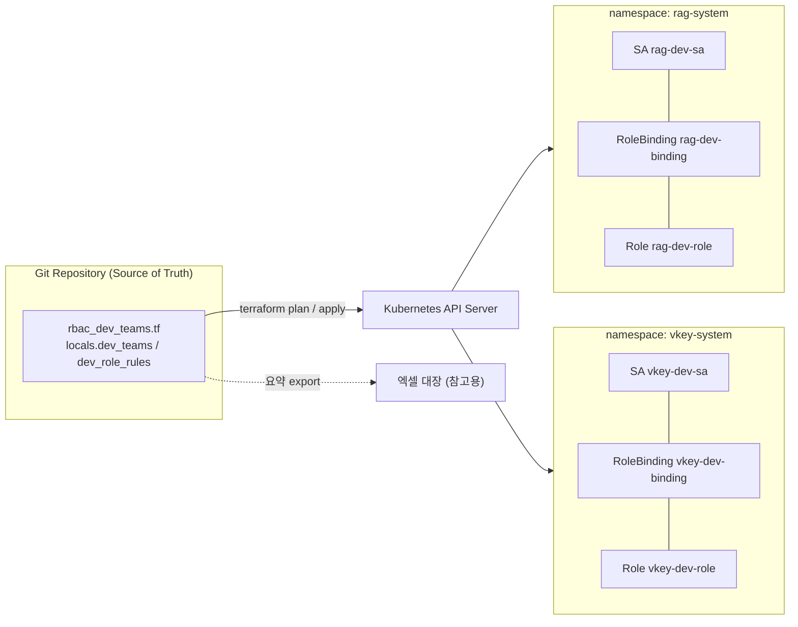

# k8s-terraform-role

> 개발팀별 Kubernetes RBAC(ServiceAccount · Role · RoleBinding)를 **Terraform 코드로 일원화**하여
> "문서(엑셀 대장)와 실제 클러스터 권한이 어긋나는 문제"를 해결한 IaC 프로젝트


---

## 1. 배경 — 어떤 문제가 있었나

- 팀별 클러스터 접근 권한을 **엑셀 대장**으로 관리하고, 실제 적용은 `kubectl apply`로 수작업 진행
- 시간이 지나며 **문서에 적힌 권한 범위와 실제 클러스터에 적용된 권한이 서로 다른 상태**가 발견됨
- "지금 누가 무엇을 할 수 있는가?"에 대해 신뢰할 수 있는 단일 출처(Single Source of Truth)가 없었음

## 2. 해결 방법

| 기존 | 개선 후 |
| --- | --- |
| 엑셀 대장 = 원본, 클러스터 = 수작업 반영 | **Terraform 코드 = 원본**, 엑셀은 코드에서 뽑은 요약본 |
| 변경 이력 추적 불가 | Git 커밋/PR로 변경 이력·리뷰 기록 |
| 실제 상태와 문서 불일치를 사람이 확인 | `terraform plan`으로 **drift 자동 감지** |
| 팀마다 YAML 복붙 | `for_each` + 공통 규칙으로 팀 추가가 map 한 줄 |

진행 순서:

1. `kubectl`로 라이브 클러스터의 실제 RBAC 상태를 조사 (2026-09-18 기준)
2. 조사한 값을 **그대로** 코드화 — 동작 변경 없이 "현재 상태를 코드로 옮기는 것"이 1차 목표
3. 기존 리소스를 `terraform import`로 state에 편입
4. `terraform plan` 결과가 **No changes**가 되는 것으로 코드 ↔ 클러스터 일치를 검증

## 3. 아키텍처



## 4. 관리 대상 권한

| 팀 | Namespace | ServiceAccount | Role | RoleBinding |
| --- | --- | --- | --- | --- |
| RAG | `rag-system` | `rag-dev-sa` | `rag-dev-role` | `rag-dev-binding` |
| VKey | `vkey-system` | `vkey-dev-sa` | `vkey-dev-role` | `vkey-dev-binding` |

두 팀 모두 동일한 Role 규칙을 사용합니다. 권한은 **Namespace 범위(Role)** 로만 부여되며 ClusterRole은 사용하지 않습니다.

배포는 ArgoCD(GitOps)가 담당하므로, 개발자 SA에는 **조회 · 디버깅 · Pod 재시작**에 필요한 권한만 남겼습니다.

| API Group | Resources | Verbs | 용도 |
| --- | --- | --- | --- |
| `""` (core) | pods | get, list, watch, delete | 조회, Pod 삭제로 재시작 |
| `""` (core) | pods/log | get, list, watch | 로그 확인 |
| `""` (core) | pods/exec, pods/portforward | get, create | 디버깅, DB 접속 |
| `""` (core) | services, configmaps, persistentvolumeclaims, events | get, list, watch | 조회 |
| `apps` | deployments, replicasets, statefulsets | get, list, watch | 조회 |
| `gateway.networking.k8s.io` | httproutes | get, list, watch | 조회 |

`secrets`는 조회 권한도 없습니다. Secret, DB, 라우트 변경은 인프라 담당(cluster-admin)이 처리합니다.

## 4-1. 권한 변경 이력

코드로 관리하면서 권한 변경도 커밋 단위로 남게 되었습니다.

| 시점 | 변경 | 이유 |
| --- | --- | --- |
| 2026-09-18 | 라이브 클러스터 RBAC를 그대로 코드화 (팀 SA에 core/apps/httproute 전체 쓰기 + secrets 접근) | 엑셀 대장과 실제 권한 불일치 해소, 현재 상태를 기준선으로 고정 |
| 2026-11-12 | 배포 목적 쓰기 권한 전부 회수, `secrets` 접근 제거, `events` 조회 추가 | 배포가 ArgoCD(deploy 저장소 PR)로 이관됨. 직접 수정해도 ArgoCD selfHeal이 되돌리므로 쓰기 권한은 위험만 남김 |
| 2026-11-12 | 개인별 cluster-admin SA 시도 후 철회 | 공용 SA 대신 개인 단위 관리자 SA를 시도했으나 실제 사용 흐름에 맞지 않아 revert. 관리자 권한은 인프라 담당으로 한정 |

## 5. 설계 결정

- **GitOps와 역할 분리**: 앱 배포·설정 변경은 ArgoCD deploy 저장소 PR로만 하고, RBAC는 이 저장소에서 관리합니다. 개발자 SA는 "보고 디버깅하는" 용도로 한정해 최소 권한 원칙을 따릅니다.
- **팀 공용 ServiceAccount**: 개인별 SA가 아니라 팀당 SA 하나를 공유하는 것은 의도된 설계입니다. 책임은 팀 단위로 지고, 인원 변동 시 RBAC 리소스를 바꿀 필요가 없습니다.
- **`automount_service_account_token = false`**: 라이브 클러스터의 실제 값에 맞추기 위해 명시했습니다. provider 기본값(`true`)과 달라 생략하면 plan에 의도치 않은 diff가 생깁니다. 이 SA는 Pod 실행용이 아닌 사람의 접근용이므로 토큰 자동 마운트를 막는 것이 보안상으로도 맞습니다.
- **데이터와 로직 분리**: 팀 정보(`local.dev_teams`)와 권한 규칙(`local.dev_role_rules`)을 리소스 정의에서 분리하여, 새 팀 추가는 map에 항목 하나만 넣으면 됩니다.
- **`dynamic "rule"` 블록**: 규칙 목록을 데이터로 두고 반복 생성하여 Role 정의의 중복을 없앴습니다.
- **클러스터 외부 실행**: Terraform은 사람 또는 CI가 클러스터 밖에서 kubeconfig로 apply하는 구조이며, in-cluster 실행은 고려하지 않습니다.

## 6. 디렉터리 구조

```
.
├── versions.tf          # Terraform / provider 버전 고정
├── providers.tf         # kubernetes provider (kubeconfig 기반)
├── variables.tf         # kubeconfig 경로, context
├── rbac_dev_teams.tf    # 팀별 SA / Role / RoleBinding 정의
└── .terraform.lock.hcl  # provider 버전 잠금
```

## 7. 사용 방법

```bash
terraform init
terraform plan -var="kube_context=<context-name>"
terraform apply -var="kube_context=<context-name>"
```

### 기존 리소스 import (최초 1회)

이미 클러스터에 존재하는 리소스를 Terraform state로 가져올 때 사용합니다.

```bash
terraform import 'kubernetes_service_account.dev["rag"]'  rag-system/rag-dev-sa
terraform import 'kubernetes_role.dev["rag"]'             rag-system/rag-dev-role
terraform import 'kubernetes_role_binding.dev["rag"]'     rag-system/rag-dev-binding

terraform import 'kubernetes_service_account.dev["vkey"]' vkey-system/vkey-dev-sa
terraform import 'kubernetes_role.dev["vkey"]'            vkey-system/vkey-dev-role
terraform import 'kubernetes_role_binding.dev["vkey"]'    vkey-system/vkey-dev-binding
```

import 후 `terraform plan`이 `No changes`를 출력하면 코드와 클러스터가 일치하는 상태입니다.

### 새 팀 추가

`rbac_dev_teams.tf`의 `local.dev_teams`에 항목을 추가합니다.

```hcl
newteam = {
  namespace            = "newteam-system"
  service_account_name = "newteam-dev-sa"
  role_name            = "newteam-dev-role"
  role_binding_name    = "newteam-dev-binding"
}
```

## 8. 보안 고려 사항

- `*.tfstate`, `*.tfvars`, `.terraform/`은 `.gitignore`로 커밋에서 제외 (state에는 리소스 상세값이 포함될 수 있음)
- 권한은 Namespace 범위로 한정 — 다른 팀 Namespace나 클러스터 전역 리소스에는 접근 불가
- 개발자 SA는 읽기 위주 권한만 보유, `secrets` 접근 불가
- Terraform은 SA 토큰 Secret을 만들지 않으므로 tfstate에 토큰이 남지 않음 (토큰은 `kubectl create token`으로 단기 발급)
- SA 토큰 자동 마운트 비활성화

## 9. 향후 개선 계획

- [ ] Remote backend(S3/GCS 등) + state locking 적용
- [ ] GitHub Actions로 PR마다 `terraform fmt -check` / `validate` / `plan` 자동 실행
- [ ] 주기적 `terraform plan`으로 drift 감지 알림
- [ ] 팀별 권한 차등이 필요해지면 `dev_role_rules`를 팀 단위 override 구조로 확장
- [x] 배포 권한 회수 및 `secrets` 접근 제거 (2026-11-12, ArgoCD 이관)
- [ ] `pods/exec` 사용 범위 재검토 (DB 접속 외 용도 제한)
